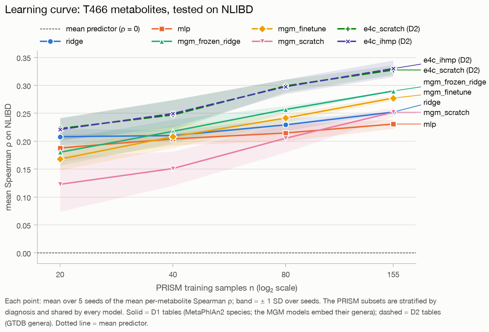

# microbe2metabolite

**Predicting a stool sample's metabolome from its microbiome, on an independent external cohort,
and testing whether pretraining helps.** PyTorch + scikit-learn, CPU only.

## 1. Question

Gut microbes make, transform and consume many of the small molecules in stool. Given a
metagenome, how well can we predict each metabolite of the *same* sample, and does pretraining
help? Three kinds of pretraining were compared:

- a published microbiome foundation model, MGM, used frozen and fine-tuned;
- self-supervised pretraining on 1,503 metagenomes from five other cohorts;
- supervised pretraining on another cohort with paired metabolomics (iHMP).

Models are trained on the PRISM IBD cohort (155 people, USA) and scored once on an independent
cohort, NLIBD (65 people, the Netherlands).

**H1:** pretrained models beat the same architecture trained from scratch on the external cohort,
and by more when labelled data are scarce. H0 is an acceptable outcome.

## 2. Main result

**On the external cohort, microbial composition predicts the metabolome moderately.** For the
427 annotated metabolites kept after filtering, ridge regression on the MetaPhlAn2 species (D1)
reaches a mean Spearman ρ = 0.25 (95% CI 0.19–0.32). 126 metabolites score above the
permutation-null threshold, led by urobilin, acylcarnitines and bile acids.

- **Pretraining helps the foundation model in 2 of 3 tests; our own pretraining does not.**
  - MGM's pretrained weights beat the identical GPT-2 with random weights when frozen with a
    ridge head (+0.067) and when fine-tuned (+0.025), but not when frozen with an MLP head
    (−0.012 [−0.048, +0.022]).
  - Self-supervised pretraining on other cohorts slightly *hurts* (−0.020); supervised iHMP
    pretraining is neutral (+0.003).
- **At point estimates, the input representation is the largest single effect, but only just.**
  - The same people profiled as GTDB genera (the curated D2 resource; 462 genera as input)
    instead of MetaPhlAn2 species (D1; 151 of 200 kept as input) gain +0.105 [+0.069, +0.141]
    in mean ρ with ridge and +0.097 [+0.063, +0.132] with the same MLP (post-hoc paired tests).
  - Close behind (post-hoc): the head on frozen MGM (ridge vs MLP) and the best vs worst
    D1-input model above the floor, both ≈ 0.09. The largest pretraining effect is +0.067.
- **Within-cohort cross-validation overestimates external accuracy for every model above the
  floor (ridge on D1 species: ρ 0.41 → 0.25) and misranks the D1-input models.** Among them,
  ridge is best on PRISM CV (0.411) but MGM frozen + ridge is best on NLIBD (0.290; post-hoc).
  Ridge on D2 genera is best on both (CV 0.440, NLIBD 0.357).

**Table 1. External test on NLIBD, T466 targets** (427 annotated metabolites kept from the 466;
65 samples). Mean ± SD over 5 seeds for stochastic models (the N columns are seed means,
rounded); 95% basic-bootstrap CI over test samples (1,000 resamples); "null" = 95th percentile of
the per-metabolite ρ pooled over 20 refits of ridge on PRISM with shuffled microbiome rows (D1
ridge, ρ > 0.360, for every D1 and D1 → MGM row; D2 ridge, ρ > 0.416, for the D2 rows); PRISM CV
ρ = the selected configuration's 5-fold CV at model seed 0. The full tables, including TALL
(6,948 features) and S176, are in [results/tables.md](results/tables.md).

| Model | Input | Mean ρ | 95% CI | Top-50 ρ | N(ρ > 0.5) | N(ρ > null) | PRISM CV ρ |
|---|---|---|---|---|---|---|---|
| Mean predictor (floor) | D1 species | 0.000 | — | 0.000 | 0 | 0 | 0.000 |
| Ridge | D1 species | 0.252 | [0.194, 0.319] | 0.589 | 50 | 126 | 0.411 |
| Elastic net (per metabolite) | D1 species | 0.255 | [0.201, 0.317] | 0.587 | 48 | 125 | 0.391 |
| Random forest | D1 species | 0.199 ± 0.005 | [0.149, 0.257] | 0.551 | 35 | 114 | 0.403 |
| MLP from scratch (E1) | D1 species | 0.231 ± 0.008 | [0.174, 0.294] | 0.580 | 44 | 117 | 0.405 |
| MGM frozen + ridge (E2) | D1 → MGM | **0.290** | [0.233, 0.350] | 0.597 | 60 | 152 | 0.360 |
| ↳ control: random-weights GPT-2 + ridge | D1 → MGM tokens | 0.223 ± 0.015 | [0.168, 0.281] | 0.515 | 27 | 93 | 0.319 |
| MGM frozen + MLP head (E2) | D1 → MGM | 0.201 ± 0.014 | [0.153, 0.254] | 0.521 | 26 | 89 | 0.344 |
| ↳ control: random-weights GPT-2 + MLP head | D1 → MGM tokens | 0.213 ± 0.020 | [0.166, 0.264] | 0.507 | 24 | 91 | 0.304 |
| MGM fine-tuned, last block (E3) | D1 → MGM | 0.277 ± 0.004 | [0.222, 0.333] | 0.573 | 48 | 141 | 0.340 |
| ↳ control: same GPT-2 trained from scratch | D1 → MGM tokens | 0.252 ± 0.008 | [0.191, 0.314] | 0.533 | 30 | 119 | 0.312 |
| Ridge | D2 genera | **0.357** | [0.308, 0.411] | 0.685 | 104 | 161 | 0.440 |
| MLP from scratch (E4c) | D2 genera | 0.328 ± 0.008 | [0.277, 0.384] | 0.670 | 96 | 147 | 0.433 |
| + self-supervised pretraining (E4a) | D2 genera | 0.308 ± 0.017 | [0.260, 0.362] | 0.654 | 87 | 137 | 0.416 |
| + iHMP supervised pretraining (E4b) | D2 genera | 0.330 ± 0.015 | [0.281, 0.385] | 0.661 | 94 | 142 | 0.427 |
| + both (E4a then E4b) | D2 genera | 0.304 ± 0.015 | [0.255, 0.357] | 0.642 | 79 | 128 | 0.405 |

**Table 2. Does pretraining help? Paired comparisons on NLIBD** (same test samples for both
models; paired bootstrap of Δ mean ρ; pre-registered in [configs/compare.yaml](configs/compare.yaml)).

| H1 test | Δ mean ρ, T466 [95% CI] | P(Δ ≤ 0) | Δ on TALL / S176 |
|---|---|---|---|
| MGM fine-tuned vs the same GPT-2 from scratch | +0.025 [+0.000, +0.047] | 0.012 | TALL +0.034 [+0.010, +0.058] |
| MGM frozen vs random-weights GPT-2, ridge head | +0.067 [+0.037, +0.094] | < 0.001 | TALL +0.047 [+0.027, +0.066] |
| MGM frozen vs random-weights GPT-2, MLP head | −0.012 [−0.048, +0.022] | 0.76 | TALL −0.006 [−0.033, +0.020] |
| Self-supervised pretraining (E4a) vs scratch | −0.020 [−0.039, −0.001] | 0.98 | S176 −0.008 [−0.022, +0.005] |
| iHMP supervised pretraining (E4b) vs scratch | +0.003 [−0.008, +0.014] | 0.34 | S176 +0.006 [−0.005, +0.018] |
| E4a then E4b vs scratch | −0.024 [−0.041, −0.006] | 0.998 | S176 −0.009 [−0.026, +0.008] |

**Figure 1. Learning curve (Q3): mean ρ on NLIBD vs the number of PRISM training samples.** Every
model trains on the same saved, diagnosis-stratified PRISM subsets (5 seeds per size). The curves
vary the training set at fixed hyperparameters: each model reuses the configuration chosen by CV
on all 155 PRISM samples, and only ridge penalties are re-chosen inside each subset. Points at
n < 155 average about 433 metabolites, because the zero filter is refit on each subset.



| Model | n = 20 | n = 40 | n = 80 | n = 155 |
|---|---|---|---|---|
| Ridge (D1) | 0.208 ± 0.015 | 0.210 ± 0.009 | 0.229 ± 0.011 | 0.252 |
| MLP (D1) | 0.188 ± 0.025 | 0.204 ± 0.011 | 0.215 ± 0.015 | 0.231 ± 0.008 |
| MGM frozen + ridge | 0.180 ± 0.024 | 0.218 ± 0.021 | 0.257 ± 0.006 | 0.290 |
| MGM fine-tuned | 0.168 ± 0.020 | 0.208 ± 0.020 | 0.241 ± 0.008 | 0.277 ± 0.004 |
| GPT-2 from scratch (control) | 0.123 ± 0.049 | 0.151 ± 0.031 | 0.205 ± 0.025 | 0.252 ± 0.008 |
| E4c scratch (D2) | 0.223 ± 0.019 | 0.247 ± 0.027 | 0.299 ± 0.011 | 0.328 ± 0.008 |
| E4c + iHMP pretraining (D2) | 0.221 ± 0.020 | 0.249 ± 0.024 | 0.298 ± 0.013 | 0.330 ± 0.015 |

Fine-tuned MGM's advantage over its from-scratch twin is larger at small n than with all 155
samples, peaking at n = 40: +0.045 at n = 20, +0.057 at n = 40, +0.036 at n = 80 and +0.025 at
n = 155. This is H1's "more at small n", but only relative to that weak control; E4c + iHMP shows
no small-n gain (within ±0.003 of E4c scratch at every n). Ridge on the same species beats both
MGM variants at n = 20; MGM frozen + ridge overtakes it from n = 40 (0.218 vs 0.210, within seed
SD) and fine-tuned MGM from n = 80. All these comparisons are post-hoc, on seed means.

## 3. Data

| | Source | Content | Licence |
|---|---|---|---|
| **D1** | [MiMeNet repository](https://github.com/YDaiLab/MiMeNet), `data/IBD/` | PRISM (155) and NLIBD (65): 200 MetaPhlAn2 species, 8,848 LC-MS features, 466 annotated; the standard split of MelonnPan, MiMeNet and mNODE | MIT |
| **D2** | [Curated gut microbiome–metabolome collection](https://github.com/borenstein-lab/microbiome-metabolome-curated-data) (Muller et al. 2022) | Franzosa 2019 (the same PRISM/NLIBD people, re-profiled as GTDB genera) plus five source cohorts: iHMP, Yachida, Wang, Erawijantari, MARS | MIT |
| **D3** | [MGM](https://github.com/HUST-NingKang-Lab/MGM) (Zhang et al., *Advanced Science*) | GPT-2 foundation model pretrained on 263k MGnify microbiomes | MIT |

All three are downloaded at pinned commits by `scripts/download_data.sh`. `make data` then checks
49 facts about them ([results/data_checks.md](results/data_checks.md)). Notable findings:

- CD/UC labels for PRISM come from D2, because D1 only has IBD/Healthy.
- 53 Erawijantari metagenomes duplicate Yachida samples and were removed, leaving 1,503 source
  samples.
- In NLIBD every control comes from LifeLines-DEEP and every patient from UMCG, so diagnosis is
  confounded with recruitment cohort.

## 4. Methods

**Preprocessing** (fit on training samples only; [src/m2m/preprocess.py](src/m2m/preprocess.py)):

- **Microbes** (D1 species; the D2 models use a fixed 462-genus vocabulary instead of the
  prevalence filter, and MGM its own tokenisation): each sample is re-closed to relative
  abundance. Taxa are kept if present (> 1e-4) in ≥ 10% of training samples, giving 151 of 200
  species. They are then CLR-transformed with a per-sample pseudocount (half the smallest
  non-zero value) and z-scored with training statistics.
- **Metabolites:** log10(x + 1), then z-scored. Metabolites that are zero in > 50% of training
  samples are dropped: T466 keeps 427, TALL keeps 6,948 of 8,848.

**Models.**

| Experiment | Model and selection |
|---|---|
| E0 | Mean predictor; multi-output ridge (alpha per metabolite by efficient leave-one-out); per-metabolite elastic net (MelonnPan-like); random forest |
| E1 | MLP 151 → 256 → 128 → M, AdamW, early stopping, the brief's grid of 8 configurations |
| E2 | MGM's own tokenisation; frozen GPT-2 embeddings (mean or last token, chosen by CV); ridge or MLP head |
| E3 | MGM fine-tuned with the last k ∈ {1, 2, 8} blocks unfrozen, backbone lr {1e-5, 3e-5}; k = 1 was selected |
| E4 | MLP on D2 genera (462-genus vocabulary from the source cohorts only): masked-feature self-supervised pretraining (E4a), supervised iHMP pretraining on the 176 shared metabolites (E4b), transfer to PRISM (E4c). Ridge on the same D2 inputs (`d2_ridge`) is the D2 baseline and gives the D2 permutation null |
| E5 | The learning curves above |
| E6 | Permutation importance of ridge (and of the E1 MLP as a second view) within PRISM CV; ρ by chemical class from the NLIBD results ([docs/interpretation_notes.md](docs/interpretation_notes.md)) |
| A1–A4 | Ablations ([results/tables.md](results/tables.md)) |

Two **H1 controls** go beyond the brief. They are the same GPT-2 with random weights, frozen (for
E2) or trained from scratch (for E3: all blocks, its own learning-rate grid), with MGM's tokens,
folds, splits and protocol. Without them, "MGM vs ridge" would mix the value of pretraining with
the architecture and tokenisation.

**Evaluation protocol** ([docs/DESIGN.md](docs/DESIGN.md)):

- **Why an external cohort:** within-cohort cross-validation is optimistic. Here every model
  above the floor drops from PRISM CV to NLIBD; for ridge on D1 species, ρ ≈ 0.41 falls to 0.25.
- **Model selection:** ridge and the elastic net tune their penalties inside each training set;
  every other tuned choice is made by 5-fold CV on PRISM, stratified by CD/UC/control, with the
  same saved folds for every model.
- **Early stopping:** uses an inner 20% split of the PRISM training data (E4a and E4b
  pretraining hold out 15% of source subjects and 20% of iHMP subjects instead). Targets are
  centred on the fit rows so that tiny training sets do not stop at initialisation.
- **Two phases, enforced in code.** `make select` never opens NLIBD through the guarded loaders
  (the D2 Franzosa tables it reads also hold NLIBD's 65 rows, which are dropped on loading) and
  ends by hashing every selection and config. That freeze was committed (commit `ce8fb15`) before
  `make evaluate` ran. Every opening of the external cohort for modelling refuses unless the
  frozen state is committed and unchanged (only the section-3 data checks, which fit nothing, are
  exempt), and every opening is logged with its purpose
  ([results/external_access_log.csv](results/external_access_log.csv)).
- **Leakage tripwire:** after every fit on PRISM, all preprocessors must have been fit on exactly
  the training IDs, otherwise the run fails.
- **Metric:** Spearman ρ per metabolite across the 65 test samples. A constant prediction or a
  metabolite constant across the test samples (ρ undefined) counts as 0. The summaries are mean,
  median, top-50 mean, N(ρ > 0.5) and N above the permutation null.
- **Uncertainty:**
  - mean ± SD over 5 seeds for stochastic models (deterministic ones are fit once);
  - a basic bootstrap CI over test samples (the percentile interval is biased low for Spearman,
    because resampled ties shrink ρ);
  - paired bootstraps for the 8 pre-registered A-vs-B pairs
    ([configs/compare.yaml](configs/compare.yaml)) and 3 post-hoc pairs
    ([results/posthoc_comparisons.csv](results/posthoc_comparisons.csv)); learning-curve and
    ablation differences are not tested.

## 5. What worked, what didn't

- **Worked: simple linear models on a good representation.**
  - Ridge on D2 genera is the best model overall (0.357).
  - Ridge on D1 species is competitive with every neural model on D1.
  - The MLP is slightly *worse* than ridge (Δ −0.021 [−0.038, −0.004]).
- **Worked: MGM's pretraining, judged against the same architecture, with a ridge head or
  fine-tuning.** Frozen MGM embeddings + ridge reach 0.290, the best D1-input model. That is
  +0.067 over random-weights embeddings of the same tokens, and +0.038 [−0.001, +0.078] over
  plain ridge (post-hoc, borderline). With an MLP head, MGM's embeddings do no better than random
  weights (−0.012 [−0.048, +0.022]).
- **Didn't work: our own pretraining.**
  - Masked-genus self-supervision on 1,503 metagenomes from five other cohorts (IBD, IBS,
    colorectal and gastric cancer, kidney disease) made transfer slightly worse.
  - iHMP supervision on 176 shared metabolites was neutral, even on the 172 of them that pass
    PRISM's zero filter (S176).
  - The E4a trunks fit their task well (masked-reconstruction validation loss −45% vs the mean
    baseline), the E4b networks only modestly (validation loss 6–9% below the mean baseline; a
    seed-0 diagnostic iHMP CV gives ρ 0.26). Neither carried over to PRISM → NLIBD.
- **Ablations: the input choices barely matter; the target transform does.**
  - Log vs CLR inputs, and 5/10/20% prevalence, change mean ρ by ≤ 0.003 for ridge.
  - CLR *targets* look better in their own space (0.261) but worse when scored against measured
    intensity (0.218). The target transform changes what is being predicted.
- **Among the D1-input models, the one PRISM CV ranks first is not the best on NLIBD
  (post-hoc).**
  - Ridge beats MGM frozen + ridge in CV (0.411 vs 0.360) but loses on NLIBD (0.252 vs 0.290).
  - Models on MGM's tokens, pretrained or not, mostly lose less from CV to NLIBD (0.060–0.096 vs
    0.136–0.204 for the species models); MGM frozen + MLP head is the exception (0.143)
    ([cv_vs_external.png](results/figures/cv_vs_external.png)).
- **Interpretation (E6 importances in PRISM CV; NLIBD ρ from the final evaluation):**
  - Urobilin is the metabolite ridge predicts best (PRISM CV ρ 0.83; NLIBD ρ 0.76 for the same
    LC-MS feature, 0.77 for a second, starred urobilin* feature). It comes from gut bacteria
    reducing bilirubin to urobilinogen, its precursor.
  - Its top taxon, a Lachnospiraceae species, agrees at class level with the Clostridia that
    carry the bilirubin reductase, but its other positive top-5 taxa are not Clostridia and no
    reducer named by Hall et al. 2024 ranks in its top 5.
  - The bile-acid pick, chenodeoxycholate, is predicted with PRISM CV ρ 0.70 (0.54 on NLIBD).
  - Single-species importances are small and noisy, probably because correlated species share
    signal; permuting one CLR column also breaks the compositional constraint, so they explain
    this model, not the microbiome. See [docs/interpretation_notes.md](docs/interpretation_notes.md)
    for the literature comparison of all 13 compounds.

**Published numbers (context, not a like-for-like benchmark).** On the same split, mNODE (Wang et
al., *Nat. Mach. Intell.* 2023) reports mean ρ 0.287, top-50 0.622 and N(ρ > 0.5) = 69, with
MiMeNet at 0.191 / 0.512 / 28 in the same figure. They score CLR(x + 1) values over the 466
annotated metabolites.

Ablation A4 refits ridge and the MLP under that protocol (CLR(x + 1) targets over all 8,848
features, no zero filter; ρ over the 466 annotated). Ridge reaches 0.262 [0.202, 0.330], top-50
0.599, N(ρ > 0.5) = 57. Its mean ρ and N(ρ > 0.5) are close to the median of mNODE's own 50
re-runs (≈ 0.263 / 57.5); its top-50 is below it (≈ 0.611). mNODE's published single run was
early-stopped on NLIBD itself; we never trained, tuned or early-stopped on NLIBD, which before
the final evaluation was opened only by the logged data checks. We do not claim to beat or match
mNODE. The full account is in [docs/published_numbers.md](docs/published_numbers.md). The brief
quoted the preprint's 0.294 / 0.642 / 93; the journal version supersedes them.

## 6. Limitations

- **One disease area and two cohorts.** PRISM and NLIBD differ in country (USA vs the
  Netherlands), recruitment and probably diet (not measured). In NLIBD, controls and patients
  come from different cohorts (LifeLines-DEEP vs UMCG). Metabolites tied to IBD status
  (acylcarnitines, bile acids, urobilin; Franzosa et al. 2019, Lloyd-Price et al. 2019) may be
  predicted partly *through* disease state rather than microbial metabolism.
- **Small n.** 155 training and 65 test samples. 95% CIs on mean ρ are about ±0.05–0.06, and
  per-metabolite ρ on 65 samples is noisy.
- **LC-MS annotation coverage.** Only 466 of 8,848 features are annotated, and their chemical
  classes are putative.
- **MGM's coverage.** MGM covers 59 of the 67 D1 genus labels (median 98% of each sample's
  abundance). Its pretraining corpus (MGnify) may contain the public PRISM metagenomes; NLIBD
  (controlled access) is unlikely to be in it.
- **Input sets fixed upstream.** D1's 200 species were pre-selected upstream, possibly using
  both cohorts. iHMP recruited partly at MGH (Lloyd-Price et al. 2019), where PRISM was
  recruited: the ID and profile checks rule out shared samples (max cross-cohort profile r = 0.85),
  not shared people.
- **The permutation null is conservative.** Metabolites co-vary, so a model trained on shuffled
  pairs still correlates with many of them by chance. N(ρ > null) is therefore strict.
- **Tuning is protocol-limited.** The E4 fine-tuning used E1's grid for every variant (a
  controlled comparison). Pretrained trunks might prefer learning rates below the grid's lowest
  (3e-4), so the negative E4 result holds for this protocol only.

## 7. Reproduce

A fresh clone needs uv, git, make, bash and network access.

```bash
make all      # env, data (download + 49 checks), MGM env, select, evaluate, EDA notebook
```

- **The two phases:** `make select` and `make evaluate` are the protocol's two phases. Before
  opening the external cohort, `make evaluate` checks that the committed freeze is unchanged and
  that src, scripts, configs, the Makefile, pyproject.toml and envs/mgm/requirements.txt are
  committed and unmodified.
- **On another platform:** re-derived selections can differ by more than float rounding: CV
  scores, the E4 network fingerprints and, where CV scores are near-tied, the chosen
  configuration. If they differ from the committed ones, `make all` stops at `make evaluate`'s
  freeze check: commit results/selected and results/splits, then run `make evaluate` and
  `make eda`.
- **Runtime:** on an Apple M4 Max laptop (macOS arm64, 14 cores, CPU only), the selection phase
  takes ≈ 20 min and the evaluation ≈ 14 min. Add ≈ 3 min (network-dependent) for downloads
  and environment setup; on Linux the MGM environment also pulls CUDA wheels.
- **Tests and lint:** `make test` (synthetic data only, ≈ 55 s) and `make lint`, after `make env`.
  CI runs both on every push.
- **Layout:** described in [docs/DESIGN.md](docs/DESIGN.md), which also lists 38 design
  decisions with the alternatives that were rejected.

## 8. How it was built

Claudio Durán set the question, the design and the evaluation standards (the project brief), and
reviews and directs the work. Claude Code (Anthropic) wrote all the code, in one end-to-end
session.

- **Agents:** parallel agents implemented the modules, and independent adversarial reviewers
  checked each package for leakage, correctness and protocol compliance.
- **Before the real run:** every final-evaluation stage ran in dry runs, with a PRISM hold-out
  standing in for NLIBD, before the single real evaluation. The code paths that open the real
  cohort, and the freeze's git check, are skipped in dry runs.
- **History:** the milestone commits M1–M5 (branches m1-data to m5-curves) were cut from the
  finished code just before the real `make select` run, and their commit messages say so.
  m5-curves also holds the freeze commit (`ce8fb15`); m6-readme holds the evaluation and this
  write-up.

## References

- **D1 (PRISM, NLIBD):** Franzosa EA et al. Gut microbiome structure and metabolic activity in
  inflammatory bowel disease. *Nat Microbiol* 4, 293–305 (2019).
- **iHMP:** Lloyd-Price J et al. Multi-omics of the gut microbial ecosystem in inflammatory bowel
  diseases. *Nature* 569, 655–662 (2019).
- **D2:** Muller E, Algavi YM, Borenstein E. The gut microbiome-metabolome dataset collection: a
  curated resource for integrative meta-analysis. *npj Biofilms Microbiomes* 8, 79 (2022).
- **MiMeNet:** Reiman D, Layden BT, Dai Y. MiMeNet: exploring microbiome-metabolome relationships
  using neural networks. *PLoS Comput Biol* 17, e1009021 (2021).
- **MelonnPan:** Mallick H et al. Predictive metabolomic profiling of microbial communities using
  amplicon or metagenomic sequences. *Nat Commun* 10, 3136 (2019).
- **mNODE:** Wang T et al. Predicting metabolomic profiles from microbial composition through
  neural ordinary differential equations. *Nat Mach Intell* 5, 284–293 (2023).
- **D3:** Zhang H et al. MGM as a large-scale pretrained foundation model for microbiome analyses
  in diverse contexts. *Adv Sci* 13, e13333 (2026).
- **BilR:** Hall B et al. BilR is a gut microbial enzyme that reduces bilirubin to urobilinogen.
  *Nat Microbiol* 9, 173–184 (2024).

MIT licence. See [CITATION.cff](CITATION.cff).
